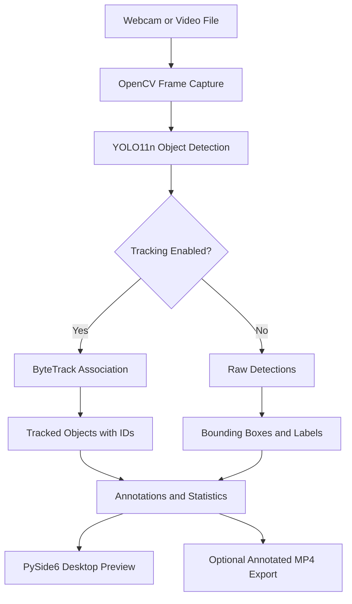

<div align="center">

# Object Detection & Tracking System

### Real-Time Computer Vision with YOLO11 and ByteTrack

**HorizonTechX — Artificial Intelligence Internship | Task 4**

A Python desktop application that detects objects in webcam feeds and video files, tracks them across frames with persistent IDs, and exports annotated video clips.


</div>

\---

## Overview

This project combines **pretrained object detection**, **multi-object tracking**, and a responsive desktop interface into a practical computer-vision application. It uses **YOLO11n** to locate and classify objects in each frame and **ByteTrack** to associate detections across frames, assigning tracking IDs such as `person #1` or `car #2`.

The application supports live webcam capture and local video files. Its **PySide6** interface provides source selection, playback controls, detection settings, live statistics, and annotated MP4 export. An OpenCV-based command-line application remains available for testing and lightweight use.

> **Project scope:** Built as Task 4 of the HorizonTechX Artificial Intelligence Internship. The model uses pretrained weights; this project focuses on inference, tracking, integration, testing, and desktop application development—not model training.

## Project Showcase

### Live Preview

Watch YOLO11n detect objects frame-by-frame while ByteTrack assigns tracking IDs, with results displayed in the desktop application.

<p align="center">
  
</p>

### Desktop Application — Initial State

The application starts with a clean interface where users can open a local video or switch to their webcam.

<p align="center">
  
</p>

### Live Detection & Tracking Example

An example of the desktop application processing a video, displaying bounding boxes, class labels, tracking IDs, and live object statistics.

<p align="center">
  
</p>

## Key Features

### Object Detection and Tracking

\- **YOLO11n inference:** Detect objects frame-by-frame using a pretrained Ultralytics model.

\- **ByteTrack multi-object tracking:** Assign persistent IDs to objects across consecutive frames.

\- **Visual annotations:** Draw bounding boxes, class names, confidence scores, and tracking IDs.

\- **Configurable detection:** Adjust confidence thresholds and use the configured IoU threshold.

\- **Detection-only mode:** Turn tracking off while retaining YOLO detections.

\- **Robust frame handling:** Process frames with no detections without crashing.

### Desktop Experience

\- **Native file picker:** Open supported video files without editing source code.

\- **Webcam input:** Start the default camera and switch sources safely.

\- **Embedded video preview:** Resize or maximize the window while preserving aspect ratio.

\- **Playback controls:** Play, pause, resume, and stop; inspect paused video frames using the frame-position slider.

\- **Interactive settings:** Change confidence, tracking, bounding-box visibility, and label visibility during a session.

\- **Live statistics:** View processing FPS, active tracks, object counts, per-class counts, source information, and tracking status.

\- **Responsive interface:** Video processing runs in a Qt worker thread to keep the UI responsive.

\- **Helpful feedback:** Display loading, processing, paused, completed, and error states.

### Export and Reliability

\- **Annotated MP4 export:** Save processed session clips with boxes, labels, IDs, and compact statistics.

\- **Original video dimensions:** Export source-resolution frames without desktop panels or display letterboxing.

\- **Safe resource cleanup:** Release camera, video writer, and processing resources when stopping or exiting.

\- **OpenCV CLI fallback:** Run detection and tracking without launching the desktop interface.

\- **Automated testing:** 48 tests passed in the latest reported validation.

## How It Works



**1. Capture:** OpenCV reads frames from a webcam or supported video file.

**2. Detect:** YOLO11n predicts object classes, confidence scores, and bounding boxes for each frame.

**3. Track:** When enabled, ByteTrack associates detections across frames to maintain object identities. IDs may change after occlusion, source switching, seeking, or tracker resets.

**4. Visualize:** The application draws annotations, computes current-frame statistics, and displays the results in the desktop interface.

**5. Export:** Optionally save processed annotated frames to an MP4 clip.

### Detection vs. Tracking

| Object detection (YOLO11n) | Object tracking (ByteTrack) |

|---|---|

| Finds and classifies objects in a frame | Associates objects across consecutive frames |

| Produces boxes, labels, and confidence scores | Produces track identities that can persist over time |

| Does not independently maintain identity | May lose or reassign IDs in difficult scenes |

## Technology Stack

| Technology | Role |

|---|---|

| Python 3.13 | Application language |

| OpenCV | Capture, frame processing, drawing, and MP4 writing |

| Ultralytics YOLO11n | Pretrained object detector |

| PyTorch | Model inference (validated on CPU) |

| Ultralytics ByteTrack | Multi-object tracking |

| NumPy | Frame and numerical operations |

| PySide6 Essentials 6.12.0 | Desktop GUI |

## Getting Started

### Prerequisites

\- Windows with Python **3.13** installed (the project's validated environment).

\- A webcam for live capture, or a supported local video file.

\- Internet access for the initial dependency installation and model-weight download.

> CPU inference is supported. Performance depends on hardware, video resolution, and model settings.

### 1. Clone the Repository

```powershell

git clone <YOUR-REPOSITORY-URL>

cd <YOUR-REPOSITORY-FOLDER>

```

Replace the placeholders with your actual GitHub repository URL and folder name.

### 2. Create and Activate a Virtual Environment

```powershell

py -3.13 -m venv .venv

.\.venv\Scripts\Activate.ps1

```

If you prefer not to activate the environment, run its Python executable directly in the following commands.

### 3. Install Dependencies

```powershell

python -m pip install --upgrade pip

python -m pip install -r requirements.txt

```

### 4. Launch the Desktop Application

```powershell

python desktop_app.py

```

Or, without activating the virtual environment:

```powershell

.\.venv\Scripts\python.exe desktop_app.py

```

Use **Open Video** to select a file or **Use Webcam** to start your camera. The pretrained YOLO weights may download automatically on the first run.

## Desktop Application Guide

| Control | What it does |

|---|---|

| Open Video | Browse for a local video file |

| Use Webcam | Switch to the default webcam |

| Play / Pause / Resume | Control frame processing |

| Stop | Stop the current source and reset the interface |

| Frame-position slider | Inspect frames in paused video-file mode |

| Confidence slider | Adjust detection confidence from 0.20 to 0.90 |

| Tracking toggle | Enable or disable ByteTrack |

| Show Boxes | Show or hide bounding boxes |

| Show Labels | Show or hide class labels and tracking IDs |

| Export | Save an annotated processing-session clip |

### Keyboard Shortcuts

| Key | Action |

|---|---|

| `Space` | Play, pause, or resume |

| `T` | Toggle tracking |

| `+` / `=` | Increase confidence by 0.05 |

| `-` | Decrease confidence by 0.05 |

| `H` | Open keyboard-shortcut help |

| `Q` | Exit the application |

| `Esc` | Stop the current source and return to Ready |

**Note:** Changing settings while paused may reprocess the frozen frame once so the preview and statistics update. Seeking or re-enabling tracking can reset tracking IDs.

## Command-Line Mode

The original OpenCV application remains available as a lightweight alternative to the desktop GUI.

**Webcam:**

```powershell

python app.py --source 0

```

**Local video file:**

```powershell

python app.py --source "input\test_video.mp4"

```

**Lower detection confidence:**

```powershell

python app.py --source "input\test_video.mp4" --confidence 0.35

```

**Detection without tracking:**

```powershell

python app.py --source "input\test_video.mp4" --no-tracking

```

**Export an annotated MP4:**

```powershell

python app.py --source "input\test_video.mp4" --save

```

In CLI mode, use `Space` to pause/resume, `T` to toggle tracking, `+`/`-` to change confidence, `H` for help, and `Q` or `Esc` to exit.

## Project Structure

```text

Object-Detection-and-Tracking-System/

├── app.py                    # OpenCV command-line application

├── desktop_app.py            # PySide6 desktop application entry point

├── config.py                 # Default application settings

├── requirements.txt          # Python dependencies

├── README.md

├── src/

│   ├── detection/            # YOLO detector and detection model

│   ├── tracking/             # ByteTrack wrapper and tracked-object model

│   ├── video/                # Capture, playback, display, seeking, export

│   ├── utils/                # CLI, statistics, visualization

│   └── gui/                  # Desktop window and background worker

├── tests/                    # Automated tests

├── models/                   # Model-related project assets

├── input/                    # Local test videos

├── output/                   # Generated annotated MP4 clips

└── assets/

    ├── images/              # README screenshots

    └── gifs/                # README demonstration GIF

```

## Testing and Validation

Run the automated test suite from the project root:

```powershell

python -m pytest

```

**Latest reported result: 48 passing automated tests.** Tests are designed to run headlessly without requiring a physical webcam, visible GUI, internet connection, or repeated model downloads.

The application has also been manually exercised with webcam and video-file sources, tracking, playback controls, and desktop interaction. For a final release check, verify a complete exported MP4 in a normal media player and test source switching and cleanup on your machine.

## Current Limitations

\- **CPU performance:** Inference speed depends on hardware and input resolution; real-time performance is not guaranteed for every source.

\- **Detection coverage:** YOLO11n is a pretrained detector with a limited set of supported object classes. Small, overlapping, occluded, or low-confidence objects may be missed.

\- **Tracking stability:** IDs are not guaranteed to remain unchanged after long occlusions, seeking, source changes, or tracker resets.

\- **Audio:** The application does not play or export the original video's audio.

\- **Export scope:** Desktop export saves an annotated **processing session/clip**, starting from the next processed frame. It does not guarantee a full re-export of the original source from the beginning.

\- **Playback speed:** When CPU inference is slower than the source frame rate, video processing may run slower than normal playback.

## Future Improvements

Potential extensions include GPU-accelerated inference, additional detector models, synchronized audio support, and optional full-source batch export. These are outside the scope of the completed internship task.

## Internship Context

This project was developed for **Task 4 of the HorizonTechX Artificial Intelligence Internship**. It demonstrates how a pretrained deep-learning detector can be combined with a multi-object tracking algorithm and packaged into a usable desktop application.

The main technical focus is the end-to-end pipeline: **video capture → object detection → temporal association → visualization → export**.

\---

<div align="center">

**Built with Python, OpenCV, YOLO11n, ByteTrack, and PySide6.**

</div>
